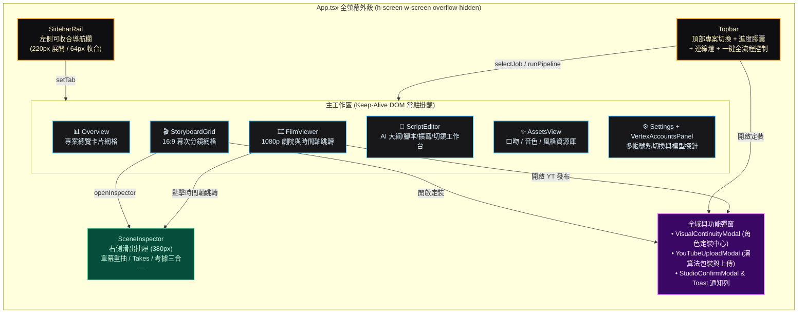
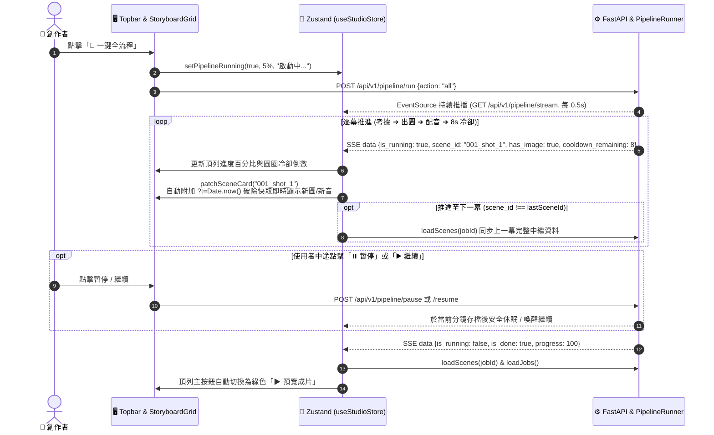
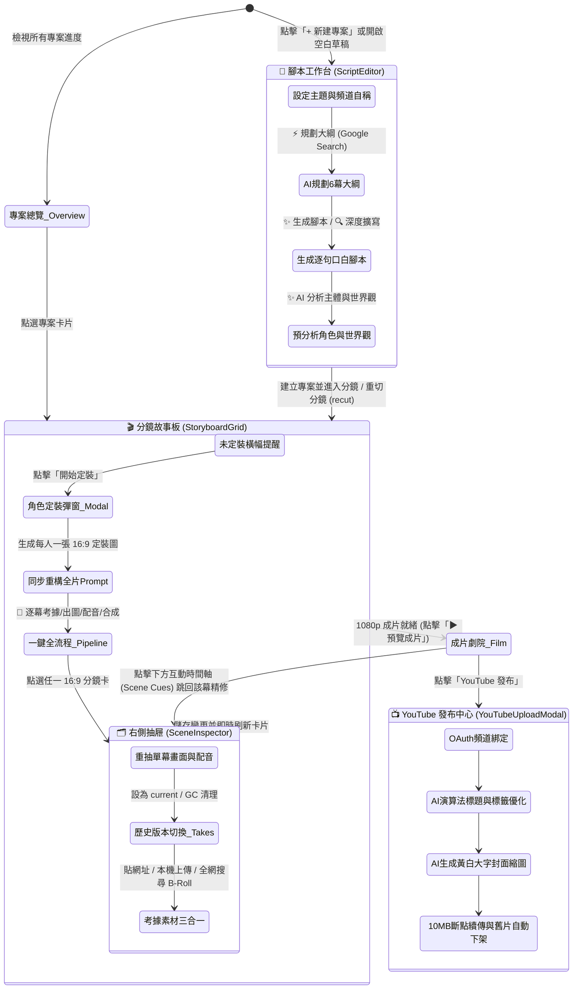

# AIVideo Studio UI 架構、流程與互動邏輯說明

> 💡 備註：本文件同時保存於 `doc/UI說明.md` 與專案根目錄 `UI說明.md`，方便直接查閱。

本文件詳細說明 **AIVideo Studio** 前端介面（`web/`）與後端 API（`aivideo/api/`）的整體架構、全域狀態管理、6 大主視圖與抽屜／彈窗元件設計、SSE 即時串流機制，以及完整的使用者操作流程。

---

## 一、UI 技術棧與前後端通訊架構

### 1.1 技術棧配置
- **前端框架**：React 18 + TypeScript + Vite（開發伺服器預設運行於 `http://localhost:5173`）。
- **狀態管理**：Zustand（`web/src/store.ts`），結合 `localStorage` 持久化保存當前分頁（`aivideo_current_tab`）、選中專案（`aivideo_selected_job`）、選用模型、頻道主自稱預設清單與未建案草稿。
- **視覺設計系統（Tailwind Cinema Theme）**：
  - 採用深色劇院級專業剪輯室配色（`cinema-bg`、`cinema-darker`、`cinema-card`、`cinema-border`），搭配琥珀金主行動色（`amber-cta`）與狀態指示色（翡翠綠 `emerald-400`、天際藍 `sky-400`、警示紅 `red-400`）。
  - 圖示庫採用 `lucide-react`。
- **後端服務**：FastAPI + Uvicorn（運行於 `http://localhost:8000`），統一提供 `/api/v1/*` REST 端點、`/api/v1/pipeline/stream` SSE 即時事件串流，以及 `/media/*` 靜態媒體掛載。

### 1.2 開發與正式環境路由代理
- **開發模式**：前端 Vite（`:5173`）透過 `vite.config.ts` 將 `/api` 與 `/media` 請求代理轉發至後端 FastAPI（`:8000`）。
- **正式打包模式**：當執行 `npm run build` 產出 `web/dist/` 後，FastAPI（`aivideo/api/app.py`）會自動偵測並將 `web/dist/` 掛載於根路徑 `/`，單一 `:8000` 埠即可同時提供前端 SPA 與後端 API。

---

## 二、前端目錄與元件階層結構

```text
web/src/
├── main.tsx                        # React 應用掛載入口
├── index.css                       # Tailwind 基礎樣式與劇院級深色捲軸/光暈特效 (glow-amber)
├── types.ts                        # 全域 TypeScript 介面定義与 AI 模型常數清單 (AI_TEXT_MODELS, AI_IMAGE_MODELS)
├── studioActions.ts                # 頻道自稱 Prompt 注入解析、Slug 正規化、主按鈕狀態推導輔助函式
├── api.ts                          # 封裝所有 /api/v1/* REST 請求與 EventSource (SSE) 訂閱器
├── store.ts                        # Zustand 全域狀態中心 (useStudioStore)
├── App.tsx                         # 主版面骨架、SSE 生命週期綁定、「總覽」與「設定」視圖、全域 Toast 與 ConfirmModal
└── components/
    ├── SidebarRail.tsx             # 左側可收合導航欄 (展開 220px / 收合 64px，6 大核心頁籤)
    ├── Topbar.tsx                  # 頂部專案切換器、圖/聲/預估片長膠囊、連線狀態燈、一鍵全流程進度控制器、更多選單
    ├── ConnectionLights.tsx        # 每 8 秒自動輪詢的 Gemini / ComfyUI / API 連線狀態呼吸燈
    ├── ScriptEditor.tsx            # 【腳本】工作台：主題、字數、頻道主自稱、故事要求 Prompt、6幕大綱、逐行口白編輯、視覺風格與切鏡節奏、角色世界觀預分析
    ├── StoryboardGrid.tsx          # 【分鏡】16:9 故事板網格：依幕次 (Act) 分組、批次操作列、PiP/Spotlight/B-Roll 即時視覺預覽
    ├── SceneInspector.tsx          # 【右側滑出抽屜】單幕精修器：重抽圖/音、Lock 鎖定、歷史 Takes 切換與 GC、AI 重構英文 Prompt、三合一考據素材管理
    ├── VisualContinuityModal.tsx   # 【彈窗】專案視覺一致性與角色定裝中心（每人一張 16:9 定裝圖生成/上傳、同步重產全片 Prompt）
    ├── FilmViewer.tsx              # 【成片】1080p 劇院播放器、可點擊跳轉分鏡的互動時間軸 (Scene Cues)、MP4/SRT/ASS 下載
    ├── YouTubeUploadModal.tsx      # 【彈窗】YouTube 演算法高 CTR 標題/標籤一鍵優化、AI 黃白大字縮圖生成、OAuth 綁定與斷點續傳發布
    └── AssetsView.tsx              # 【素材】全域三大資產管理：說書人口吻 (含 Vertex AI 逐字稿萃取)、發音人音色 (含語氣設計工坊與即時試聽)、視覺風格畫廊
```

---

## 三、整體版面配置（Layout Architecture）

AIVideo Studio 採用**全螢幕零外層捲動（`h-screen w-screen overflow-hidden`）**的工作室佈局，切分為四大區域（下方提供 **視覺化高擬真版面配置預覽** 與 **Mermaid 元件拓撲圖**）：

### 3.1 視覺化版面配置縮圖（Visual UI Wireframe）

<div style="background:#09090b;border:2px solid #27272a;border-radius:12px;overflow:hidden;font-family:system-ui,-apple-system,sans-serif;color:#f4f4f5;box-shadow:0 20px 25px -5px rgba(0,0,0,0.6);margin:16px 0;">
  <div style="display:flex;min-height:420px;">
    <!-- 1. Left SidebarRail -->
    <div style="width:155px;background:#0f0f12;border-right:1px solid #27272a;display:flex;flex-direction:column;justify-content:space-between;padding:12px 10px;">
      <div>
        <div style="color:#f59e0b;font-weight:700;font-size:13px;padding:4px 6px 12px;border-bottom:1px solid #27272a;margin-bottom:10px;">
          🎥 AIVideo <span style="font-size:10px;font-family:monospace;">Studio</span>
        </div>
        <div style="font-size:12px;color:#a1a1aa;padding:6px 8px;border-radius:6px;">📊 總覽 (Overview)</div>
        <div style="font-size:12px;color:#a1a1aa;padding:6px 8px;border-radius:6px;">📝 腳本 (Script)</div>
        <div style="font-size:12px;color:#f59e0b;background:#18181b;border-left:3px solid #f59e0b;padding:6px 8px;border-radius:4px;font-weight:600;margin:4px 0;">🎬 分鏡 (Storyboard)</div>
        <div style="font-size:12px;color:#a1a1aa;padding:6px 8px;border-radius:6px;">🎞️ 成片 (Film)</div>
        <div style="font-size:12px;color:#a1a1aa;padding:6px 8px;border-radius:6px;">✨ 素材 (Assets)</div>
        <div style="font-size:12px;color:#a1a1aa;padding:6px 8px;border-radius:6px;">⚙️ 設定 (Settings)</div>
      </div>
      <div style="font-size:11px;color:#71717a;text-align:center;border-top:1px solid #27272a;padding-top:8px;">
        ◀ 收合導航 (220px/64px)
      </div>
    </div>
    <!-- 2. Right Main Area -->
    <div style="flex:1;display:flex;flex-direction:column;background:#09090b;">
      <!-- 2a. Topbar -->
      <div style="height:46px;background:#0f0f12;border-bottom:1px solid #27272a;display:flex;align-items:center;justify-content:space-between;padding:0 14px;font-size:11px;">
        <div style="display:flex;align-items:center;gap:8px;">
          <span style="background:#18181b;border:1px solid #3f3f46;padding:4px 10px;border-radius:6px;color:#f4f4f5;">📁 20261023_Michelin · 製作中 ▾</span>
          <span style="color:#a1a1aa;">🔄</span>
          <span style="color:#f59e0b;font-weight:600;">＋ 新建</span>
        </div>
        <div style="background:#18181b;border:1px solid #27272a;border-radius:999px;padding:3px 12px;color:#d4d4d8;">
          🟠 圖 <b style="color:#34d399;">18/18</b> · 🔵 聲 <b style="color:#34d399;">18/18</b> · ⏱️ <b>03:42</b>
        </div>
        <div style="display:flex;align-items:center;gap:8px;">
          <span style="color:#34d399;font-family:monospace;font-size:10px;">● Gemini ● Comfy</span>
          <span style="background:#f59e0b;color:#09090b;font-weight:700;padding:5px 12px;border-radius:6px;">🚀 一鍵全流程</span>
          <span style="color:#a1a1aa;font-size:14px;">⋮</span>
        </div>
      </div>
      <!-- 2b. Sub-toolbar + Canvas + Inspector Drawer -->
      <div style="flex:1;display:flex;overflow:hidden;">
        <!-- Center Canvas -->
        <div style="flex:1;padding:14px;display:flex;flex-direction:column;gap:12px;">
          <!-- Sub-toolbar -->
          <div style="display:flex;align-items:center;justify-content:space-between;background:#18181b;border:1px solid #27272a;border-radius:8px;padding:6px 12px;font-size:11px;">
            <div style="display:flex;gap:8px;align-items:center;">
              <span style="background:#27272a;padding:3px 8px;border-radius:4px;">🖼️ 出圖</span>
              <span style="background:#27272a;padding:3px 8px;border-radius:4px;">🔊 配音</span>
              <span style="background:#27272a;padding:3px 8px;border-radius:4px;color:#f59e0b;">▶ 合成</span>
              <span style="background:#27272a;padding:3px 8px;border-radius:4px;color:#f59e0b;">✨ 重構全片 Prompt</span>
              <span style="color:#a1a1aa;">☑️ 考據 PiP</span>
            </div>
            <span style="color:#a1a1aa;font-family:monospace;">大綱 6 幕 · 鏡頭 18 張</span>
          </div>
          <!-- Act Group Header -->
          <div style="font-size:12px;font-weight:600;color:#e4e4e7;">第 1 幕 · 賣輪胎的為何評鑑法式料理 (4 鏡)</div>
          <!-- 16:9 Cards Grid -->
          <div style="display:grid;grid-template-columns:repeat(2,1fr);gap:10px;">
            <!-- Card 1 (Selected) -->
            <div style="background:#18181b;border:2px solid #f59e0b;border-radius:8px;overflow:hidden;">
              <div style="height:88px;background:linear-gradient(135deg,#1e1b4b,#0f172a);position:relative;padding:6px;display:flex;align-items:center;justify-content:center;">
                <span style="position:absolute;top:5px;left:5px;background:#064e3b;color:#34d399;font-size:9px;padding:1px 6px;border-radius:4px;">✓ 已完成</span>
                <span style="color:#94a3b8;font-size:10px;">[16:9 分鏡畫面預覽]</span>
                <div style="position:absolute;right:6px;top:18px;width:44px;height:44px;background:#fff;border-radius:4px;color:#000;font-size:8px;display:flex;align-items:center;justify-content:center;text-align:center;box-shadow:0 4px 8px rgba(0,0,0,0.5);">白框<br/>PiP卡</div>
                <span style="position:absolute;bottom:5px;left:5px;background:#3b0764;color:#e9d5ff;font-size:9px;padding:1px 5px;border-radius:4px;">📷 PiP: 1900 Guide</span>
                <span style="position:absolute;bottom:5px;right:5px;background:rgba(0,0,0,0.8);color:#d4d4d8;font-size:9px;font-family:monospace;padding:1px 5px;border-radius:4px;">00:08</span>
              </div>
              <div style="padding:8px;font-size:11px;">
                <div><b style="color:#f59e0b;font-family:monospace;">01</b> <b>如果你今天要去吃一頓</b> 🔒</div>
                <div style="color:#a1a1aa;font-size:10px;margin-top:2px;">居然是一家賣輪胎的嗎 [surprise-wa]...</div>
              </div>
            </div>
            <!-- Card 2 (Spotlight) -->
            <div style="background:#18181b;border:1px solid #27272a;border-radius:8px;overflow:hidden;">
              <div style="height:88px;background:#000;position:relative;padding:6px;display:flex;align-items:center;justify-content:center;">
                <span style="position:absolute;top:5px;left:5px;background:#064e3b;color:#34d399;font-size:9px;padding:1px 6px;border-radius:4px;">✓ 已完成</span>
                <span style="position:absolute;top:5px;right:5px;background:#f59e0b;color:#000;font-weight:700;font-size:9px;padding:1px 5px;border-radius:4px;">🏛️ 黑底歷史聚焦</span>
                <div style="border:1.5px solid #fff;padding:6px 12px;border-radius:3px;color:#e4e4e7;font-size:10px;background:#18181b;">歷史原照慢推 (免 AI 生圖)</div>
                <span style="position:absolute;bottom:5px;right:5px;background:rgba(0,0,0,0.8);color:#d4d4d8;font-size:9px;font-family:monospace;padding:1px 5px;border-radius:4px;">00:07</span>
              </div>
              <div style="padding:8px;font-size:11px;">
                <div><b style="color:#f59e0b;font-family:monospace;">02</b> <b>1900年第一本米其林指南</b></div>
                <div style="color:#a1a1aa;font-size:10px;margin-top:2px;">它就是一本硬核的道路生存手冊...</div>
              </div>
            </div>
          </div>
        </div>
        <!-- 2c. Right SceneInspector Drawer -->
        <div style="width:235px;background:#18181b;border-left:1px solid #27272a;padding:12px;display:flex;flex-direction:column;justify-content:space-between;font-size:11px;">
          <div style="display:flex;flex-direction:column;gap:8px;">
            <div style="display:flex;justify-content:space-between;border-bottom:1px solid #27272a;padding-bottom:6px;font-weight:600;">
              <span>第 01 / 18 幕 ◀ ▶</span>
              <span style="color:#a1a1aa;">✕</span>
            </div>
            <div style="height:72px;background:#000;border:1px solid #3f3f46;border-radius:6px;display:flex;align-items:center;justify-content:center;color:#a1a1aa;font-size:10px;">
              16:9 大預覽 + 鎖定 (🔒圖 / 🔒音)
            </div>
            <div style="display:flex;gap:4px;">
              <span style="flex:1;background:#0f0f12;border:1px solid #27272a;text-align:center;padding:4px;border-radius:4px;font-size:10px;">🔄 重抽畫面</span>
              <span style="flex:1;background:#0f0f12;border:1px solid #27272a;text-align:center;padding:4px;border-radius:4px;font-size:10px;">🎙️ 重錄配音</span>
            </div>
            <div style="background:#0f0f12;border:1px solid #27272a;padding:6px;border-radius:4px;font-size:10px;color:#d4d4d8;">
              📝 <b>旁白口白</b> / ✨ <b>English Prompt</b><br/>
              📷 <b>考據三合一</b> (貼網址 / 上傳 / 全網搜尋)
            </div>
          </div>
          <div>
            <div style="background:#f59e0b;color:#09090b;font-weight:700;text-align:center;padding:6px;border-radius:6px;margin-bottom:6px;">
              💾 儲存變更
            </div>
            <div style="background:#064e3b;border:1px solid #059669;color:#a7f3d0;font-size:10px;padding:5px 8px;border-radius:6px;text-align:center;">
              🔔 Toast: 第 1 幕畫面更新完成！
            </div>
          </div>
        </div>
      </div>
    </div>
  </div>
</div>

### 3.2 介面元件階層與版面拓撲圖（Mermaid）



1. **常駐掛載機制（Keep-Alive DOM）**：
   - 在 `App.tsx` 中，`StoryboardGrid`、`ScriptEditor`、`FilmViewer`、`AssetsView` 四個核心工作分頁透過 CSS `hidden` / `flex` 切換而非卸載元件，確保使用者在「腳本」與「分鏡」或「素材」之間來回切換時，**已輸入的表單狀態與捲軸位置 100% 保留**。
2. **自訂非阻塞互動系統（零原生彈窗）**：
   - **Toast 通知列**：右下角浮動顯示成功（3.5 秒自動消失）與錯誤訊息（停留 8 秒並附帶「一鍵複製錯誤訊息」按鈕）。
   - **`StudioConfirmModal`**：以 Promise 封裝的 `requestConfirm()` 與 `requestPrompt()` 完全取代瀏覽器突兀的 `window.confirm` 與 `window.prompt`，支援 `Enter` 確認、`Escape` 取消與危險操作紅框警示（`variant: "danger"`）。

---

## 四、Zustand 全域狀態與 SSE 即時串流邏輯

### 4.1 `useStudioStore`（`web/src/store.ts`）核心職責
- **專案與草稿雙模式切換**：
  - `selectJob(jobId)`：切換至既有專案，同步該專案的 `image_model`，關閉右側抽屜並載入該專案的所有分鏡 `loadScenes(jobId)`。
  - `startNewDraft()`：清除 `selectedJobId`，進入 `isDraftMode: true`，遞增 `draftResetKey` 重置 `ScriptEditor` 表單，並自動跳轉至「腳本」頁籤建立新案。
- **局部無閃爍卡片更新（`patchSceneCard`）**：
  - 當背景流水線完成某一幕的生圖、配音或考據時，直接更新 `scenes` 陣列中該幕的狀態，並自動在圖片／音訊 URL 後方加上 `?t=${Date.now()}` 時間戳（Cache Busting），**不需重新載入整個網頁即可看到最新生圖與配音**。

### 4.2 SSE 即時進度串流（`/api/v1/pipeline/stream`）
在 `App.tsx` 中，每當 `selectedJobId` 改變時，前端自動透過 `EventSource` 訂閱後端 `PipelineRunner` 的每 0.5 秒快照：
1. **執行中（`data.is_running === true`）**：
   - 更新頂列 `Topbar` 的進度百分比、緊湊階段文字（如 `#3 繪製畫面`、`#3 合成語音`、`配額冷卻 6s`）與暫停狀態（`is_paused`）。
   - 即時呼叫 `patchSceneCard()` 點亮當前分鏡卡片的「圖／聲」完成狀態；當推進到下一幕（`data.scene_id !== lastSceneId`）時，自動觸發一次 `loadScenes()` 確保上一幕所有中繼資料完整同步。
2. **完成或中斷（`data.is_done` 或 `data.error`）**：
   - 自動解除執行鎖定、刷新專案與分鏡列表；若有錯誤則彈出紅色 Toast 提示。



---

## 五、六大主要視圖與核心元件流程詳解

以下為創作者在 Studio 六大視圖、抽屜與彈窗之間的操作流轉狀態圖：



### 5.1 【總覽】專案管理面板（`App.tsx` -> `currentTab === "overview"`）
- **功能**：以雙欄卡片網格列出 `jobs/` 目錄下所有專案（依最後修改時間倒序排列）。
- **四維進度指標**：每張專案卡片即時展示：
  1. `畫面產出 (x / total)`
  2. `語音配音 (y / total)`
  3. `成片狀態 (已合成 / 待合成)`
  4. `YouTube 狀態 (已發布連結バッジ / 未發布)`
- **互動**：點擊卡片直接載入該專案並進入「分鏡」故事板；點擊垃圾桶圖示經確認後徹底刪除專案目錄。

---

### 5.2 【腳本】AI 企劃與前製工作台（`ScriptEditor.tsx`）
支援 **「新專案草稿（New Mode）」** 與 **「編輯既有專案（Edit Mode）」** 兩種模式，流程由上而下分為 6 個區塊：

1. **主題、目標字數與資料夾 Slug**：
   - 輸入腳本主題時，若使用者未手動改過 Slug，會自動透過 `asciiSlug()` 產生英文資料夾後綴（預覽將建立的 `jobs/YYYYMMDD_slug`）。
   - 字數滑桿支援 `300 ~ 5000 字`（步進 100 字），自動換算預估片長（以每分鐘約 220 字估算）。
2. **🎯 故事要求／必寫看點（Custom Prompt）與頻道主自稱快捷列**：
   - 提供「我是白兔」、「我是黑貓」、「無自稱（直接破題）」與「+ 新增頻道名」膠囊按鈕。點選後透過 `applyChannelPersonaToPrompt()` 自動在指定 Prompt 第一行寫入 `開頭: 大家好~我是白兔!`。
   - 此區塊內容獨立永久保存（未建案時存 `localStorage`，已建案時失去焦點自動寫入 `outline.md`），**點擊下方生成大綱時絕不會覆蓋此處內容**。
3. **📑 6 幕故事大綱（Outline）**：
   - 點擊「⚡ 依上方 Prompt 規劃 6 幕大綱」呼叫 `/api/v1/script/generate-outline`，由 Gemini 聯網檢索並產生 6~8 幕結構大綱，自動展開並存檔，使用者可自由增刪微調。
4. **口吻、發音人與視覺風格選擇列**：
   - 三欄並排選擇「說書人口吻風格（Tone）」、「專案發音人（OmniVoice）」與「視覺風格（點擊『更換』開啟全螢幕風格畫廊 Modal，支援依『動漫熱血／唯美日系／硬核科幻／藝術手繪』分類篩選與關鍵字搜尋）」。
5. **📖 故事腳本即時預覽與編輯區**：
   - 頂部工具列提供：
     - **「✨ 生成逐句腳本」**：依主題、大綱、指定 Prompt、口吻與目標字數生成一行一句口白。
     - **「🔍 深度擴寫情節」**：針對現有腳本補充對白與歷史數據，將字數擴充至目標字數（或現有字數 $+20\%$）。
     - **「🪄 智慧分行」**：前端即時正則排版，將貼上的長段落按標點拆分為標準 15~30 字的一句一行格式，並過濾禁用標點。
6. **切鏡節奏（Visual Pacing）與 🎭 視覺一致性特徵預分析（Character & Entity Bible）**：
   - 選擇切鏡節奏：`🚀 緊湊快節奏 (1~2句/圖)`、`🎬 標準電影感 (2~4句/圖)`、`☕ 沉浸長鏡頭 (3~5句/圖)`。
   - 點擊「✨ AI 分析腳本主體與世界觀」可在建案前預先提煉所有登場角色／道具（可手動切換 `👤 人物立繪` 或 `📦 道具/載具`）與共用環境錨點。
   - 點擊底部主按鈕 **「建立專案並進入分鏡」**（或編輯模式下的 **「寫回此專案」**，若口白有變更會詢問是否重切分鏡 `recutJob`，重切時保留同鏡頭 ID 的既有素材）。

---

### 5.3 【分鏡】16:9 故事板網格與頂部控制列（`StoryboardGrid.tsx` + `Topbar.tsx`）

1. **未定裝提醒橫幅（Setup Banner）**：
   - 若專案尚無任何角色定裝圖（`hasHeroImage === false`），分鏡頁頂部會浮現琥珀金提示列：「尚未定裝。先為角色產出參考圖，後面出圖才會長得像同一個人。」，點擊「開始定裝」即開啟 `VisualContinuityModal`。
2. **分鏡工具列（Sub-toolbar）**：
   - 提供單項批次按鈕：**「出圖」**（僅補齊缺圖分鏡）、**「配音」**（僅補齊缺音分鏡）、**「合成」**（前置檢查所有分鏡是否皆具備圖與音，若有缺漏會精確列出缺圖/缺音幕次並阻擋合成）、**「重構全片 Prompt」**（依最新角色定裝與風格重寫全片英文 Prompt）。
   - 提供 **「考據 PiP」** Job 級開關與 **「預估片長」** 即時統計。
3. **依大綱幕次（Act）分組的 16:9 卡片網格**：
   - 自動依據 `act_index` 與 `act_title` 將鏡頭分組顯示（如 `第 1 幕 · 賣輪胎的為何評鑑法餐`）。
   - 每張分鏡卡片直觀呈現：
     - **左上角狀態徽章**：`已完成`（綠）、`缺圖`（黃）、`待考據`（黑底聚焦模式且尚未抓圖）、`缺聲`（藍）。
     - **畫面預覽層**：自動根據考據狀態切換顯示「🎬 全螢幕考據影片（自動靜音循環預覽 `pip.mp4`）」、「🏛️ 黑底歷史聚焦原照」、或「AI 分鏡圖 + 右側置中白框拍立得 PiP 小卡」。
     - **左下角考據標籤**：顯示命中的考據檢索詞（`聚焦: ...` 或 `PiP: ...`）或考據失敗原因。
     - **右下角時長標籤**：顯示該幕實際語音秒數（如 `00:08`）。
     - **底部標題與鎖定圖示**：若有鎖定圖片或配音，顯示金色鎖頭 `Lock` 圖示。

---

### 5.4 【右側抽屜】單幕分鏡精修器（`SceneInspector.tsx`）
點擊任一張分鏡卡片時從右側滑出（寬度 `380px`），支援透過頂部 `<` `>` 按鈕快速切換上一幕／下一幕：

1. **16:9 大圖預覽與單幕鎖定（Locks）**：
   - 支援「鎖畫面」與「鎖配音」獨立切換，鎖定後批次重抽或誤按重抽皆會保護跳過。
2. **單幕重抽畫面／重錄配音（自動先存檔 + 背景輪詢更新）**：
   - 點擊「重抽畫面」或「重錄配音」時，會**先自動將目前修改的口白與英文 Prompt 寫回 `scene.yaml`**，再啟動後端背景任務，並以每 2 秒一次的計時器自動輪詢，完成瞬間直接在抽屜與網格上無縫更新預覽。
   - 旁側附有「清空此幕圖片（`ImageOff`）」與「清空此幕配音（`MicOff`）」按鈕，可將單幕重置回待生成狀態。
3. **歷史抽卡版本庫（Takes History & GC）**：
   - 橫向列出該幕所有抽過的 `畫面 takes` 縮圖與 `配音 takes` 清單，點擊任一版本即可呼叫 `/takes/select` 立即設為 `current`；點擊「gc 舊 takes」可一鍵清理舊檔（保留 current 與最新 3 個）。
4. **口白與英文 Prompt 連動轉譯**：
   - 修改中文旁白後，點擊英文 Prompt 右上角的 **「🔄 重構 Prompt」**，即可呼叫 `/translate-prompt` 依據專案畫風與角色錨點重新生成該幕的英文 Prompt 與登場 `character_ids`。
5. **三合一真實考據素材管理（PiP / Spotlight / B-Roll）**：
   - **「貼網址」頁籤**：貼上任意網路圖片或影片 URL（含直鏈或支援 `yt-dlp` 解析之網址），經 Gemini AI 審查與口白吻合後直接套用。
   - **「本機上傳」頁籤**：直接上傳本機歷史圖片（JPG/PNG/WEBP）或影片檔（MP4/WEBM/MOV），本機上傳預設直接信任套用。
   - **「全網搜尋」頁籤**：輸入實體關鍵字（如 `莫斯科街頭 1989`），一鍵跨 NASA、Wikimedia、Internet Archive 與全網檢索出多張候選影片（標示 `🎬 影片 B-Roll`）與照片（標示 `📷 照片`）縮圖，點選任一候選即透過 AI 驗證並套用。
   - **呈現方式切換**：可自由切換 `📌 畫中畫小卡 (PiP)`（可調 20%/24%/30% 大小與 6 種疊加位置）或 `🏛️ 黑底歷史聚焦 (Spotlight)`。

---

### 5.5 【彈窗】專案視覺一致性與角色定裝中心（`VisualContinuityModal.tsx`）
可從分鏡頁頂部提示列或右上角「⋮ 更多 -> 視覺定裝」開啟：
1. **環境與光影基調（全片共用）** 與 **「出圖時將各角色定裝圖作為視覺參考」總開關**。
2. **角色／道具定裝卡片網格（每人一張 16:9 定裝圖）**：
   - 每張卡片可編輯名稱、切換實體類型（`👤 人物立繪` / `📦 道具/載具`）、編輯英文外觀特徵。
   - 支援「生成此張」（單獨由 Gemini 生圖）、「上傳」（自訂上傳參考圖）、「移除圖」，或點擊頂部 **「依風格生成全部定裝圖」** 批次產出所有角色定裝圖。
   - 若修改了角色名稱、外觀或類型，後端 `invalidate_changed_character_images()` 會自動清除過期的舊定裝圖，防止舊圖干擾。
3. **「🔄 依風格與錨點重產分鏡 Prompt」**：定裝調整完畢後，一鍵將最新角色設定同步至全片所有分鏡的 `image_prompt` 與 `character_ids`。

---

### 5.6 【成片】1080p 劇院預覽與 YouTube 發布中心（`FilmViewer.tsx` + `YouTubeUploadModal.tsx`）

1. **成片劇院播放器（`FilmViewer.tsx`）**：
   - 內建 16:9 HTML5 影片播放器（自動附加版本時間戳防止快取舊片），頂部提供 **「重新載入」**、**「YouTube 發布」**，以及 **`.mp4`**、**`.srt`**、**`.ass`** 一鍵下載按鈕。
   - **互動式分鏡時間軸（Scene Cues Bar）**：播放器下方依據每幕真實配音時長比例繪製時間軸色塊，滑鼠懸停顯示幕次標題與起始秒數，**點擊任一時間軸區塊即可直接跳轉回「分鏡」頁並打開該幕的 `SceneInspector` 抽屜進行精修**。
2. **YouTube 發布彈窗（`YouTubeUploadModal.tsx`）**：
   - **AI 演算法一鍵最佳化**：點擊頂部橫幅按鈕，由 Gemini 分析故事產出 3 組高點擊率候選標題（點擊任一候選即可套用）、前言懸念說明欄與高搜尋量 Tags，所有修改皆有 600ms Debounce 自動儲存草稿至 `compose/youtube_metadata.json`。
   - **Google OAuth 頻道綁定區**：顯示已綁定頻道的頭像、名稱與自訂網址；未綁定時引導匯入 `client_secret.json` 並彈出 Google 登入視窗，授權成功後透過 `postMessage` 自動更新狀態。
   - **✨ AI 生成黃白標題封面縮圖**：一鍵呼叫 Gemini 3.1 Flash 結合專案畫風與角色定裝圖，直接繪製帶有當前選定標題「黃白立體黑邊大字」的 16:9 專屬縮圖（`compose/thumbnail.png`）。若頻道尚未完成 YouTube 手機簡訊驗證（中階功能資格）導致 API 無法自動設縮圖，完成畫面會貼心提供「下載已生成的黃白封面圖」與「前往 YouTube Studio」快捷按鈕。
   - **既有上架影片處理**：若該專案已發布過，支援「同步更新資訊／補傳縮圖（不重傳影片）」，或在重傳新片時選擇將舊版影片「自動設為私人下架（預設推薦）」、「徹底刪除」或「保留共存」。

---

### 5.7 【素材】全域創作資產庫（`AssetsView.tsx`）
分為三大子頁籤，點選任一卡片會在右側展開專屬編輯抽屜：
1. **說書人口吻（Tones）**：
   - 新增口吻支援 **「✨ Vertex AI 智慧萃取直接寫入（推薦）」**（上傳 `.txt/.md` 或貼上逐字稿，自動去識別化並提煉敘事公式寫入 `assets/tones/<id>.md`）與 **「手動填寫欄位」**。
   - 點選既有口吻後，右側抽屜亦提供 **「✨ 逐字稿 AI 重新分析更新」** 頁籤，可用新逐字稿直接覆蓋升級原口吻檔。
2. **發音人音色（Voices - OmniVoice）**：
   - 支援 **「聲音克隆（Clone）」**（上傳 5~15 秒乾淨參考音訊，後端自動透過 FFmpeg 正規化為 44.1kHz 單聲道 `reference.wav` 並配對 `reference.txt`）與 **「語氣設計（Design）」**（內建性別、年齡層、音高、12 種中文方言與耳語氣音的視覺化標籤組合器 `OMNIVOICE_CATEGORIES` 與 7 種推薦預設）。
   - **合成試聽（Audition）**：抽屜內建測試台詞輸入框與「生成新參數試聽效果」按鈕，即時呼叫 ComfyUI 合成 `preview.wav` 並於下方播放器試聽語速與位置溫度效果。
3. **視覺風格（Styles）**：
   - 管理 `assets/styles.yaml` 中的所有畫風卡片，支援更換 16:9 預覽圖、編輯正向前綴（`Style Prefix`）與負向過濾詞（`Negative Prompt`）。

---

### 5.8 【設定】憑證、模型探針與健康檢測（`App.tsx` + `VertexAccountsPanel.tsx`）
1. **`VertexAccountsPanel`（Vertex AI 憑證與多帳戶管理）**：
   - 列出所有已儲存的憑證卡片（標示 `當前使用中` 或 `備用`、認證類型、Project ID、Location、服務帳號 Email 或遮罩後的 API Key）。
   - 支援 **「載入本機 gcloud 憑證」**（一鍵同步系統 ADC）、**「測試連線」**、**「切換使用」**（免重啟即時寫入 `.env` 與環境變數）與 **「新增帳戶 / 憑證」**。
2. **AI 文本大模型與生圖模型選擇面板**：
   - 點擊「⚡ 檢測模型可用性」或進入設定頁時，自動顯示每個模型在當前帳號下的即時狀態徽章（`可用 XXms` 綠燈、`需啟用 API` 黃燈、`額度耗盡` 紅燈、`權限不足` 紅燈、`未開放` 灰燈）。
   - 點選任一文本模型或生圖模型卡片即可切換全域預設模型（若目前已選中專案，切換生圖模型會同步寫入該專案的 `job.yaml`）。
3. **`SettingsHealthPanel`（連線與預設資產檢測）**：
   - 提供「檢測 Gemini」、「檢測 Comfy」、「全部檢測」按鈕、呼吸燈號，以及預設發音人、口吻庫清單與 ASS 字幕字型檔案路徑檢視。

---

## 六、前後端 API 端點對照總表（`/api/v1`）

| 模組分類 | HTTP 方法與路徑 | 前端呼叫方法 (`web/src/api.ts`) | 功能說明 |
| :--- | :--- | :--- | :--- |
| **系統與憑證** | `GET /system/status` | `api.getSystemStatus()` | 檢查 Gemini 憑證、ComfyUI `:8188` 連線、字型與口吻清單 |
| | `POST /system/check` | `api.checkConnections(target)` | 手動觸發 `gemini` / `comfy` / `all` 連線檢測 |
| | `GET /system/accounts` | `api.getVertexAccounts()` | 取得所有已儲存的 Vertex AI / API Key 帳戶清單 |
| | `POST /system/accounts` | `api.createVertexAccount(data)` | 新增帳戶（支援 `adc`、`service_account`、`api_key`） |
| | `POST /system/accounts/sync-gcloud` | `api.syncGcloudAccount()` | 一鍵從作業系統本機 gcloud ADC 同步建立並啟用帳戶 |
| | `POST /system/accounts/{id}/activate` | `api.activateVertexAccount(id)` | 切換作用中帳戶並即時同步 `.env` 與 `os.environ` |
| | `POST /system/accounts/{id}/test` | `api.testVertexAccount(id)` | 發送輕量探針測試該帳戶連線與回應延遲 |
| | `DELETE /system/accounts/{id}` | `api.deleteVertexAccount(id)` | 刪除指定備用帳戶與其金鑰檔 |
| | `GET /system/models/status` | `api.getModelsStatus()` | 讀取 60 秒內的文本／生圖模型可用性檢測快取 |
| | `POST /system/models/check` | `api.checkModelsAvailability()` | 強制重新探測所有文本與生圖模型的授權與配額狀態 |
| **腳本生成** | `POST /script/generate-outline` | `api.generateOutline(...)` | 由 AI 聯網檢索並生成 6~8 幕故事大綱 |
| | `POST /script/generate` | `api.generateScript(...)` | 生成逐句純口白腳本並回傳字數與預估秒數 |
| | `POST /script/expand` | `api.expandScript(...)` | 針對現有腳本進行情節與數據深度擴寫 |
| **專案與定裝** | `GET /jobs` / `GET /jobs/{id}` | `api.getJobs()` / `getJobDetail(id)` | 取得所有專案進度摘要／單一專案完整設定與腳本 |
| | `POST /jobs` | `api.createJob(data)` | 建立新專案、提煉錨點、AI 語意切鏡、生成分鏡 Prompt 與考據詞 |
| | `PATCH /jobs/{id}` | `api.updateJob(id, patch)` | 更新專案設定、口白、大綱、錨點或 PiP 開關 |
| | `POST /jobs/{id}/recut` | `api.recutJob(id, data)` | 依新口白重切分鏡（保留同鏡頭 ID 之既有圖/音/takes） |
| | `POST /jobs/{id}/clear[-images\|-audio]` | `api.clearJobMedia/Images/Audio` | 清空全片所有已生成素材／僅清空圖片／僅清空配音 |
| | `POST /jobs/analyze-anchors` | `api.analyzeAnchors(...)` | 建案前預先分析腳本角色／道具清單與環境光影錨點 |
| | `GET/PATCH /jobs/{id}/anchors` | `api.getJobAnchors` / `updateJobAnchors` | 讀取或更新專案的角色外觀清單、環境錨點與參考圖開關 |
| | `POST /jobs/{id}/anchors/hero` | `api.generateHeroAnchor(jobId)` | 依專案風格批次為所有角色各生成一張 16:9 定裝圖 |
| | `POST /jobs/{id}/anchors/characters/{cid}/hero` | `api.generateCharacterHero(...)` | 單獨生成／上傳／刪除指定角色的定裝圖 |
| | `POST /jobs/{id}/anchors/sync-prompts` | `api.syncScenePrompts(jobId)` | 依最新角色定裝與風格，批次重寫全片所有分鏡的英文 Prompt |
| **分鏡與抽屜** | `GET /jobs/{id}/scenes` | `api.getScenes(jobId)` | 取得全片分鏡卡片列表（含幕次分組、圖/音/考據狀態與秒數） |
| | `GET/PATCH /jobs/{id}/scenes/{sid}` | `api.getSceneDetail` / `patchScene` | 讀取或局部更新單幕口白、Prompt、Locks 或 PiP 設定 |
| | `POST /jobs/{id}/scenes/{sid}/translate-prompt` | `api.translateScenePrompt(...)` | 將單幕中文口白重構為英文 `image_prompt` 與 `character_ids` |
| | `POST/DELETE /jobs/{id}/scenes/{sid}/image` | `api.regenerateImage` / `clearSceneImage` | 單幕背景重抽畫面／清空單幕圖片 |
| | `POST/DELETE /jobs/{id}/scenes/{sid}/audio` | `api.regenerateAudio` / `clearSceneAudio` | 單幕背景重錄配音／清空單幕配音 |
| | `GET /jobs/{id}/scenes/{sid}/takes` | `api.getSceneTakes(...)` | 列出單幕歷史圖片與配音 Takes（含 `select` 切換與 `gc` 清理） |
| | `GET/POST/DELETE .../scenes/{sid}/pip*` | `api.getScenePipCandidates` 等 | 單幕考據候選搜尋、貼網址套用、本機上傳與清除考據素材 |
| **流水線管線** | `POST /pipeline/run` | `api.runPipeline(...)` | 啟動背景流水線（`all`、`images`、`tts`、`pip`、`compose`） |
| | `POST /pipeline/pause\|resume\|stop` | `api.pause/resume/stopPipeline` | 即時暫停（當前分鏡完成後休眠）、繼續或安全中止流水線 |
| | `GET /pipeline/stream` | `api.subscribePipeline(...)` | SSE 即時進度串流（每 0.5 秒推播進度、冷卻秒數與當前分鏡狀態） |
| **素材庫** | `GET/POST/PUT/DELETE /assets/tones` | `api.getTones` / `extractAndSaveTone` 等 | 口吻範本 CRUD 與 Vertex AI 逐字稿智慧萃取寫入 |
| | `GET/POST/PUT/DELETE /assets/voices` | `api.getVoices` / `testVoice` 等 | 發音人音色 CRUD 與 ComfyUI OmniVoice 即時試聽合成 |
| | `GET/POST/PUT/DELETE /assets/styles` | `api.getStyles` / `createStyle` 等 | 視覺風格畫廊 CRUD 與預覽圖 Base64 上傳 |
| **YouTube** | `GET /youtube/status` | `api.getYouTubeStatus()` | 查詢 YouTube OAuth 綁定狀態與當前頻道頭像/名稱 |
| | `POST /youtube/auth/secret` | `api.uploadYouTubeSecret(...)` | 儲存 `client_secret.json` 內容 |
| | `GET /youtube/auth/url` & `/callback` | `api.getYouTubeAuthUrl()` | 產生含 PKCE 之 Google OAuth 網址並處理瀏覽器回調換票 |
| | `GET /youtube/prepare/{job_id}` | `api.prepareYouTubeUpload(jobId)` | 準備預設標題、說明欄、草稿與已上架影片記錄 |
| | `POST /youtube/optimize-metadata` | `api.optimizeYouTubeMetadata(jobId)` | 由 Gemini 生成 3 組高 CTR 標題、說明欄與搜尋標籤 |
| | `POST /youtube/generate-thumbnail` | `api.generateYouTubeThumbnail(...)` | 由 Gemini 3.1 Flash 生成 16:9 黃白立體大字封面縮圖 |
| | `POST /youtube/upload` & `/update-existing` | `api.uploadToYouTube(...)` | 啟動 10MB 斷點續傳背景上傳，或直接更新既有 YouTube 影片 |
