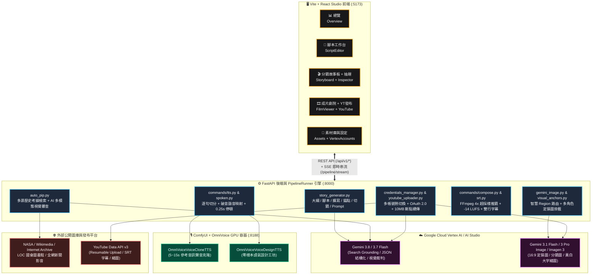
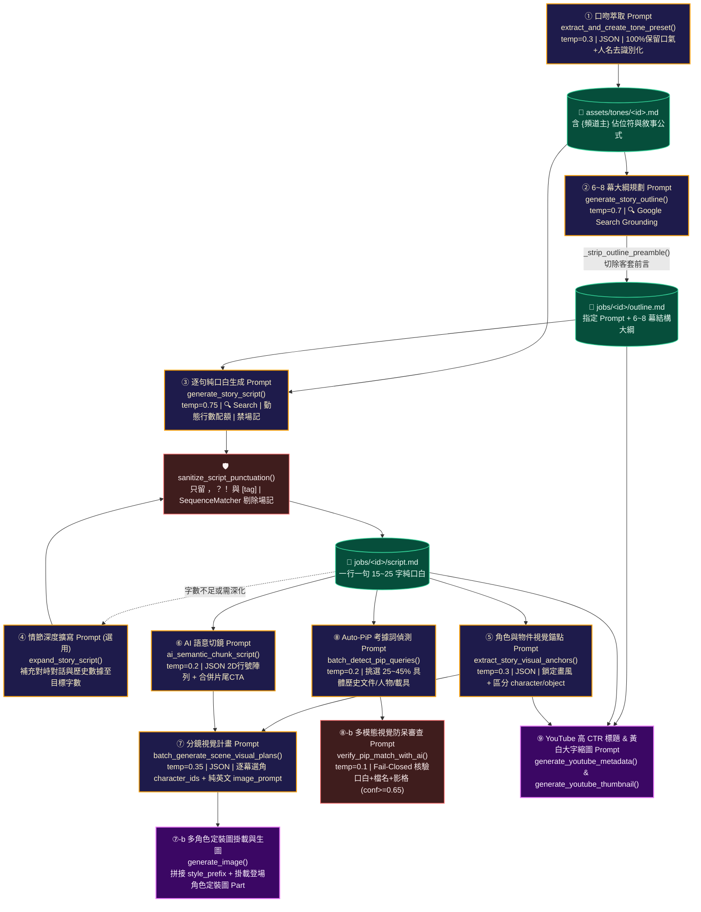
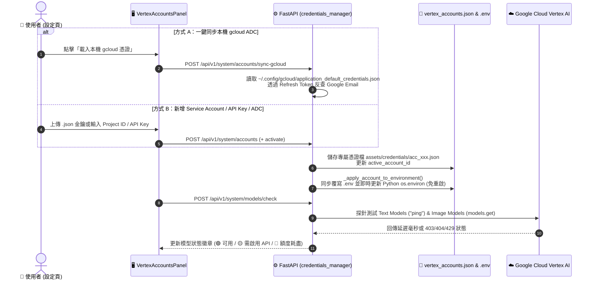
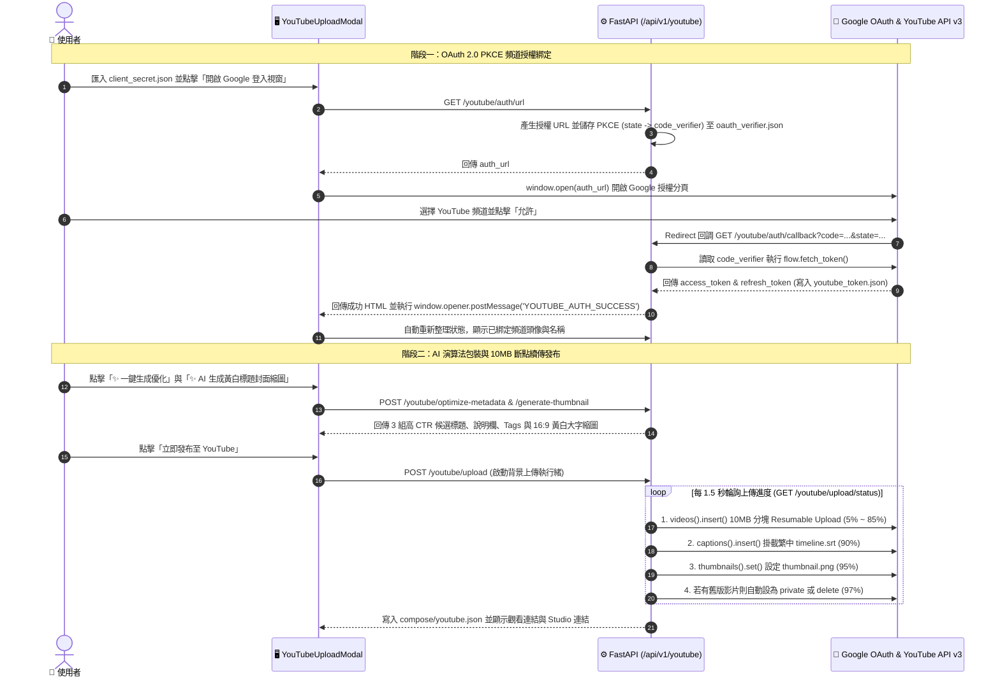

# AIVideo 專案完整架構、流程、LLM 提示詞與帳號管理說明

本文件完整說明 **AIVideo** 專案的目錄結構、核心執行邏輯、CLI 與 Studio 用法、LLM（Google Gemini / Vertex AI）的呼叫架構與 9 大階段 Prompt 設計邏輯，以及 **Vertex AI 帳號**與 **YouTube 頻道帳號**的登入、新增與切換流程。

---

## 一、專案定位與系統架構總覽

**AIVideo** 是一套專為「深度說書人／知識型紀錄片頻道」打造的端到端 AI 影片自動化生產系統。系統結合了：
1. **Google Gemini / Vertex AI（LLM 與生圖）**：負責聯網資料考據（Google Search Grounding）、6~8 幕故事大綱規劃、4000 字長篇口白撰寫、說書人口吻萃取、角色與環境視覺錨點（Character & Entity Bible）提煉、AI 語意切鏡、分鏡英文生圖 Prompt 生成、16:9 角色定裝圖與分鏡畫面繪製、多模態真實考據素材（PiP / B-Roll）審核，以及 YouTube 高 CTR 演算法標題與黃白立體字縮圖生成。
2. **ComfyUI + OmniVoice（語音合成 TTS）**：透過 GPU 容器執行 `OmniVoice-bf16` 模型，支援 **聲音克隆（Voice Clone）** 與 **語氣設計（Voice Design）** 兩種模式，具備繁簡自動轉換、破音字諧音校正、副語言情緒標籤（如 `[surprise-wa]`、`[sigh]`）解析與逐句時間軸測量。
3. **跨來源歷史考據引擎（Auto-PiP & B-Roll）**：自動檢索 NASA 官方影音庫、Wikimedia Commons、Internet Archive、美國國會圖書館（LOC）、中英文維基百科與全網新聞圖片／影片，並由 Gemini 多模態視覺裁判（Fail-Closed）審核通過後，以「畫中畫白底小卡（PiP）」、「黑底歷史聚焦慢推（Spotlight）」或「全螢幕動態 B-Roll（`pip.mp4`）」合成入片。
4. **FFmpeg 1080p 成片合成管線**：採用平行多執行緒渲染、4 倍超採樣（`4*iw` 約 7680px）抗抖動 Ken Burns 緩慢推鏡、廣播級響度標準化（`-14 LUFS`），以及智慧避頭尾雙行 SRT / ASS 字幕產生與 YouTube 自動斷點續傳發布。



---

## 二、專案目錄與檔案結構說明

```text
AIVideo/
├── .devcontainer/                  # VS Code Dev Container 薄配置與 Dockerfile
├── docker-compose.yml              # 定義 pipeline (Python/FFmpeg :8000) 與 comfyui (GPU :8188) 服務
├── pyproject.toml                  # Python 套件定義與 CLI 入口 (`aivideo = aivideo.cli:main`)
├── .env                            # 當前作用中的環境變數（由憑證管理器自動同步寫入）
├── aivideo/                        # 後端核心套件
│   ├── cli.py                      # CLI 指令入口 (`aivideo check/images/tts/srt/compose/...`)
│   ├── pipeline_runner.py          # 背景執行緒任務控制器（支援一鍵 all、暫停 pause、繼續 resume、停止 stop）
│   ├── run_state.py                # 將執行狀態落盤至 `jobs/<id>/run.json`，防止重新整理遺失進度
│   ├── story_generator.py          # LLM 核心：大綱、腳本、擴寫、標點清洗、口吻萃取、錨點提煉、切鏡、分鏡 Prompt
│   ├── gemini_image.py             # Gemini 影像生成封裝、Region 智慧路由快取、多張定裝圖掛載、429 退避重試
│   ├── visual_anchors.py           # 角色與物件定裝管理（Character & Entity Bible、定裝圖路徑與變更失效清理）
│   ├── auto_pip.py                 # 跨圖庫/影音庫真實考據檢索與 Gemini 多模態審查裁判
│   ├── acts.py                     # 從大綱解析「第 N 幕」並按篇幅權重自動映射至各分鏡鏡頭
│   ├── scene_cut.py                # 重切分鏡時保留既有同 ID 的圖片、配音與歷史 takes
│   ├── spoken.py                   # 破音字諧音字典映射（僅送 TTS）與 OmniVoice 情緒標籤剝離（供字幕）
│   ├── style_prompt.py             # 將視覺風格前綴（`style_prefix`）安全拼接至分鏡 `image_prompt`
│   ├── takes.py                    # 分鏡歷史版本（`takes/image_*.png`, `speech_*.wav`）管理、切換 current 與 GC
│   ├── locks.py                    # 分鏡圖片／配音鎖定（Lock/Unlock），防止批次重抽覆蓋滿意成果
│   ├── job_files.py                # 專案設定檔瘦身邊界：`job.yaml`、`outline.md`、`anchors.yaml` 分離讀寫
│   ├── film_cues.py                # 讀取各場語音真實秒數以建立成片時間軸章節（Cues）
│   ├── fonts.py                    # 字幕字型解析（優先 `assets/fonts/`，備援系統 Noto Sans CJK TC）
│   ├── media.py                    # FastAPI `/media` 靜態資源安全掛載白名單
│   ├── naming.py                   # 專案 ID（`YYYYMMDD_slug`）、分鏡資料夾命名與預設常數
│   ├── credentials_manager.py      # Vertex AI 多帳號管理（ADC / Service Account / API Key）與模型探針檢測
│   ├── youtube_uploader.py         # YouTube OAuth 2.0 授權、AI 高 CTR 標題/標籤生成、黃白字縮圖與斷點續傳
│   ├── commands/                   # 各子命令實作 (`check`, `images`, `tts`, `srt`, `compose`, `preview`, `tones`, `voices`, `youtube`, `lock`)
│   └── api/                        # FastAPI 應用程式與 `/api/v1` 路由 (`system`, `jobs`, `scenes`, `pipeline`, `assets`, `youtube`)
├── assets/                         # 全域共用創作資產庫
│   ├── styles.yaml                 # 28+ 種大師級視覺風格定義（含 `prefix`, `negative`, `preview`）
│   ├── styles/previews/            # 視覺風格預覽縮圖 (`*.jpg`)
│   ├── tones/                      # 說書人口吻範本庫 (`*.md`，含 YAML Frontmatter、示範口白與敘事公式)
│   ├── voices/                     # OmniVoice 發音人音色庫 (`<voice_id>/voice.yaml`, `reference.wav`, `reference.txt`, `preview.wav`)
│   ├── prompts/                    # 提示詞規格說明範本 (`story_generation_template.md`)
│   ├── fonts/                      # 字幕專用字型檔
│   └── credentials/                # 認證機密目錄 (`vertex_accounts.json`, `models_cache.json`, `client_secret.json`, `youtube_token.json`)
├── jobs/                           # 各影片專案獨立工作目錄
│   └── <YYYYMMDD_slug>/            # 單一專案資料夾（詳見下方「Job 檔案邊界」）
└── web/                            # Vite + React + TypeScript + Tailwind 前端 Studio 介面
```

### 單一專案（`jobs/<job_id>/`）檔案邊界設計

為了保持設定檔乾淨可讀，系統透過 `./aivideo/job_files.py` 將專案資料拆分為職責明確的檔案：

```text
jobs/20261023_Michelin/
├── job.yaml                        # 精簡核心設定（標題、語音 ID、畫風 ID、解析度、FPS、字幕模式）
├── outline.md                      # 儲存「指定 Prompt（故事要求）」與「6~8 幕故事大綱」
├── anchors.yaml                    # 儲存視覺錨點（Characters 角色/物件外觀清單、Environment 環境光影）
├── script.md                       # 完整故事腳本（一行一句純口白）
├── run.json                        # PipelineRunner 最新執行進度快照
├── preview.html                    # 靜態離線可檢視的故事板網頁
├── characters/                     # 各角色／核心道具的 16:9 定裝基準圖 (`<char_id>.png`)
├── compose/                        # 成片合成與發布輸出目錄
│   ├── film.mp4                    # 最終 1080p 成片
│   ├── film.json                   # 成片中繼資料（解析度、FPS、是否燒錄字幕、生成時間）
│   ├── narration.wav               # 全片合併後的完整旁白音軌
│   ├── timeline.srt                # 依每句真實語音時長對齊的 SRT 字幕檔（供 YouTube 掛載）
│   ├── timeline.ass                # 1920x1080 樣式化 ASS 字幕檔（供燒錄字幕使用）
│   ├── thumbnail.png               # 專為 YouTube 生成的 16:9 黃白立體大字封面縮圖
│   ├── youtube_metadata.json       # YouTube 標題、候選標題、說明欄、Tags 草稿
│   └── youtube.json                # 已發布至 YouTube 的 Video ID、網址與狀態記錄
└── scenes/                         # 分鏡資料夾（按序號排列）
    └── 001_shot_1/
        ├── scene.yaml              # 單幕設定（口白、英文 image_prompt、登場 character_ids、locks、current、pip 設定）
        ├── image.png               # 當前選用的畫面（由 takes/ 複製而來）
        ├── image.json              # 當前畫面生成參數（model, seed, prompt）
        ├── speech.wav              # 當前選用的配音（由 takes/ 複製而來）
        ├── speech.json             # 當前配音參數與「逐句精確起迄秒數 `sentences` 陣列」
        ├── pip.png                 # 真實考據照片（或考據影片的代表縮圖）
        ├── pip.mp4                 # 真實考據動態影片（當啟用 B-Roll 全螢幕考據影片時存在）
        └── takes/                  # 歷史抽卡版本庫 (`image_20261023T120000.png`, `speech_20261023T120100.wav` 等)
```

---

## 三、核心工作流程與執行邏輯

以下為從「靈感主題」到「1080p 成片合成與 YouTube 發布」的端到端圖形化主流程：

```mermaid
flowchart TD
    classDef step fill:#18181b,stroke:#f59e0b,stroke-width:2px,color:#fef3c7
    classDef cond fill:#1e1b4b,stroke:#818cf8,stroke-width:2px,color:#e0e7ff
    classDef action fill:#0f172a,stroke:#38bdf8,stroke-width:1.5px,color:#e0f2fe
    classDef skip fill:#064e3b,stroke:#10b981,stroke-width:2px,color:#d1fae5
    classDef out fill:#3b0764,stroke:#c084fc,stroke-width:2px,color:#f3e8ff

    subgraph S1["階段 1 & 2：AI 企劃、腳本與語意切鏡"]
        A1["🎯 輸入主題 + 頻道主自稱 + 故事要求"]:::step --> A2["📑 AI 聯網規劃 6~8 幕大綱 (outline.md)"]:::action
        A2 --> A3["✍️ 生成逐行純口白腳本 + 標點/場記清洗 (script.md)"]:::action
        A3 --> A4["🎭 提煉角色/物件錨點 (anchors.yaml)<br/>+ ✂️ AI 語意切鏡 + 分鏡英文 Prompt"]:::action
    end

    subgraph S2["階段 3：角色與道具定裝 (Visual Continuity)"]
        A4 --> B1{"是否需要固定<br/>角色/道具外觀？"}:::cond
        B1 -->|是| B2["🎨 生成每人一張 16:9 定裝圖<br/>(人物立繪模板 / 物件反擬人化模板)"]:::step
        B1 -->|略過| C0
        B2 --> C0["🚀 啟動 PipelineRunner (一鍵全流程逐幕迴圈)"]:::step
    end

    subgraph S3["階段 4：逐幕推進迴圈 (Scene 1 ... Scene N)"]
        C0 --> C1{"0. 本幕為 Spotlight 黑底聚焦<br/>或動態 B-Roll 考據需求？"}:::cond
        C1 -->|是| C2["🌐 優先檢索 NASA/Wiki/Archive 影片或原照<br/>並經 Gemini 多模態審查 (Fail-Closed)"]:::action
        C2 --> C3{"AI 審查通過？"}:::cond
        C3 -->|通過! 取得 pip.mp4 或 pip.png| C4["⚡ 自動跳過本幕 AI 生圖<br/>(省下 Gemini 配額與 8s 冷卻)"]:::skip
        C3 -->|未通過: 自動降級| C5
        C1 -->|否: 一般分鏡| C5["🎨 1. Gemini 16:9 生圖<br/>(自動拼接畫風 Prefix + 掛載登場角色定裝圖)"]:::action
        C4 --> C6["🎙️ 2. ComfyUI OmniVoice 逐句語音合成<br/>(破音諧音校正 ➔ 簡體合成 ➔ 插入 0.25s 停頓)"]:::action
        C5 --> C6
        C6 --> C7{"3. 一般 PiP 小卡模式<br/>且有考據檢索詞？"}:::cond
        C7 -->|是| C8["📷 檢索並經 AI 審查套用右半部白框小卡 (pip.png)"]:::action
        C7 -->|否| C9
        C8 --> C9{"4. 本幕曾呼叫 Gemini 生圖<br/>且非最後一幕？"}:::cond
        C9 -->|是| C10["⏳ 8 秒平滑配額冷卻倒數"]:::action
        C9 -->|否| C11{"還有下一幕？"}:::cond
        C10 --> C11
        C11 -->|是| C1
    end

    subgraph S4["階段 5：FFmpeg 1080p 成片合成與 YouTube 發布"]
        C11 -->|全部完成| D1["📝 依 speech.json 逐句真實秒數<br/>生成雙行避頭尾 timeline.srt / .ass"]:::action
        D1 --> D2["🎬 4 執行緒平行渲染 seg_XXX.mp4<br/>(4*iw 超採樣抗抖動推鏡 + PiP 45%處淡入)"]:::action
        D2 --> D3["🔊 音軌合流 + 廣播級響度標準化 (-14 LUFS)<br/>輸出 compose/film.mp4"]:::out
        D3 --> D4["📺 YouTube 演算法高 CTR 標題 + 黃白大字縮圖<br/>+ 10MB 斷點續傳上架"]:::out
    end
```



### 階段 1：故事企劃、大綱與逐句腳本生成
1. **設定頻道主自稱與指定要求（Custom Prompt）**：
   - 使用者可選擇頻道主自稱（如「我是白兔」、「我是黑貓」或「無自稱（直接破題）」）並輸入故事要求／必寫看點。
2. **AI 聯網規劃 6~8 幕大綱（`generate_story_outline`）**：
   - 啟用 Google Search Grounding 聯網檢索真實歷史與數據，結合選定的「說書人口吻（Tone）」產生 6~8 幕結構化大綱，自動存於 `outline.md`。
3. **生成逐行純口白腳本（`generate_story_script`）與深度擴寫（`expand_story_script`）**：
   - 嚴格依據目標字數（如 1500～4000 字）換算目標行數（每行約 18～22 字），生成**一行一句**的純口白台詞。
   - 生成後立即執行 `sanitize_script_punctuation()`，自動過濾任何誤輸出的幕次標題、場記、後設說明，並將標點嚴格收斂為只含 `，`、`？`、`！` 與 OmniVoice 情緒標籤。

### 階段 2：角色／物件視覺錨點提煉與 AI 語意切鏡
1. **提煉角色與物件聖經（`extract_story_visual_anchors`）**：
   - 掃描腳本並鎖定專案選定的畫風（`style_lock_instructions`），提煉最多 6 個核心登場實體（區分 `entity_type: "character"` 人物立繪 與 `"object"` 非生物道具／載具），以及全片共用的 `environment_anchor`（世界觀與光影色盤）。
2. **AI 語意切鏡（`parse_script_lines_to_scenes`）**：
   - 依使用者選定的切鏡節奏（`fast` 1~2句、`balanced` 2~4句、`slow` 3~5句），由 Gemini 分析情節轉折將腳本行號切分為多個分鏡區塊（Chunks）。
   - **片尾 CTA 自動合併（`merge_trailing_cta_chunks`）**：若最後一幕為訂閱、按讚等結尾呼籲詞且句數 $\le 3$ 句，自動併入倒數第二幕，避免為訂閱詞單獨產出一張無意義畫面。
3. **批次生成分鏡英文 Prompt 與出場角色 ID（`batch_generate_scene_visual_plans`）**：
   - 為每一幕同時決定「實際出場的 `character_ids`」與「100% 純英文 `image_prompt`」。
4. **批次偵測真實考據檢索詞（`batch_detect_pip_queries`）**：
   - 為約 25%~45% 提及具體歷史人物、合約文件、特定船艦／光刻機／望遠鏡的分鏡預先寫入精準考據檢索詞（`pip.query`）與呈現模式（`pip` 小卡或 `spotlight` 黑底聚焦）。
5. **大綱幕次映射（`acts.py`）**：
   - 將 `outline.md` 的「第一幕～第 N 幕」依各幕正文長度權重自動分配至各分鏡的 `act_index` 與 `act_title`。

### 階段 3：角色定裝基準圖生成（Visual Continuity）
- 建立專案後，可在「分鏡頁 -> 視覺定裝」為每位角色或關鍵道具生成一張 16:9 定裝圖（存於 `characters/<id>.png`）。
- **人物 vs. 道具雙模板防呆（`build_character_hero_prompt`）**：
  - 若 `entity_type == "character"`：使用全身標準立繪模板（強調五官、髮型、服裝配色、乾淨背景）。
  - 若 `entity_type == "object"`：使用無生命實體道具展示模板，**強制加入嚴格反擬人化禁令**（`NO eyes, NO mouth, NO face, NO limbs, NO anthropomorphism`），防止將潛水艇、可樂瓶或機器畫成長手長腳的卡通人物。

### 階段 4：一鍵全流程管線（`PipelineRunner` mode="all"）
當點擊「🚀 一鍵全流程」時，`PipelineRunner` 會在背景執行緒**逐幕推進**，每完成一步即更新 `run.json` 並透過 SSE 推播至前端：
1. **步驟 0：考據先行判定（Spotlight / B-Roll 優先）**：
   - 若該幕設定為黑底歷史聚焦（`spotlight`）或動態事件（`should_prefer_archival_video`），優先跨來源檢索真實影片或歷史原照並送交 Gemini 多模態審查。
   - **省配額機制**：一旦該幕成功取得全螢幕考據影片（`pip.mp4`）或黑底聚焦原照（`pip.png`），**該幕自動跳過 AI 生圖（`need_img = False`）**，直接省下生圖 API 配額與冷卻時間。
2. **步驟 1：單幕 Gemini 出圖（`run_images`）**：
   - 自動拼接畫風前綴（`compose_styled_prompt`），並根據該幕 `scene.yaml` 的 `character_ids` 精準讀取對應角色的 `characters/<id>.png` 定裝圖一併送入 Gemini。
   - 支援 **原地重試（In-Place Retry，最多 3 次）** 與批次結束後的 **自動補漏自癒輪次（Auto-Healing Pass）**。
3. **步驟 2：單幕 ComfyUI OmniVoice 配音（`run_tts`）**：
   - 將該幕旁白切分為每句 15~26 字的子句（`split_sentences`，過短碎句自動整併）。
   - 每句先經過 `prepare_tts_text()` 替換破音字諧音（保留 `[tag]` 情緒標籤），再用 `zhconv` 轉為簡體中文送入 ComfyUI `OmniVoice-bf16` 合成。
   - 用 `ffprobe` 量測每句真實時長，句與句之間自動插入 `0.25 秒` 靜音軌（`anullsrc`），合併為 `speech.wav`，並將每句的 `start_sec` / `end_sec` 寫入 `speech.json`（供後續產生毫秒級精準字幕）。
4. **步驟 3：常規畫中畫考據圖（PiP 小卡）**：
   - 若該幕為一般 `pip` 模式且有 `pip.query`，自動抓取並經 AI 視覺審核後存為 `pip.png`。
5. **步驟 4：配額保護冷卻（8 秒倒數）**：
   - 僅在該幕實際呼叫過 Gemini 生圖後，進行 8 秒平滑冷卻（前端頂列即時顯示倒數秒數），防止觸發 Google Cloud 429 速率限制。
6. **步驟 5：FFmpeg 1080p 成片合成（`run_compose`）**：
   - 先呼叫 `generate_srt()` 依 `speech.json` 內的逐句真實秒數產出 `timeline.srt` 與 `timeline.ass`（每行最多 18 字、最多 2 行、自動避頭尾標點）。
   - 以 `ThreadPoolExecutor`（最多 4 執行緒）平行渲染每幕視訊片段 `seg_XXX.mp4`：
     - **一般畫面**：先放大至 `4*iw`（約 7680px 超採樣網格）再執行 `zoompan` 緩慢推鏡，徹底消除 FFmpeg 整數座標造成的畫面抖動（Sub-pixel Jitter）。
     - **畫中畫模式（`mode: pip`）**：在該幕進行至約 45%~48% 時，於指定位置（預設右半部置中 `right-center`）淡入帶白邊的拍立得質感考據小卡。
     - **黑底聚焦模式（`mode: spotlight`）**：在 4x 黑底畫布中央放置加白框的歷史原照並緩慢推鏡淡入。
     - **全螢幕考據影片（`mode: broll` / `pip.mp4`）**：直接以無聲 1080p 歷史影片循環或裁切對齊該幕語音時長。
   - 串接全部視訊與音訊，套用 FFmpeg `loudnorm=I=-14:TP=-1.5:LRA=11` 將音量標準化至 YouTube 廣播級 `-14 LUFS`，輸出 `compose/film.mp4` 與離線故事板 `preview.html`。

---

## 四、CLI 指令與日常用法速查

進入 Dev Container 後，可直接使用 `aivideo`（或 `python -m aivideo`）執行所有管線指令：

```bash
# 1. 環境與連線健康檢查
aivideo check                   # 檢查基礎環境與憑證
aivideo check --gpu             # 測試 CUDA 容器與 GPU
aivideo check --gemini          # 產出一張 16:9 煙霧測試圖至 jobs/_smoke/

# 2. 資源庫管理
aivideo voices                  # 列出 assets/voices/ 所有發音人與參考音就緒狀態
aivideo tones                   # 列出 assets/tones/ 所有說書人口吻範本
aivideo tones --import-file sample.txt --id my_tone  # 由 Vertex AI 萃取文字檔建立新口吻範本

# 3. 分鏡生圖與配音
aivideo images --job jobs/20261023_Michelin          # 為所有未出圖分鏡生成 16:9 畫面
aivideo images --job jobs/20261023_Michelin --scene 001 --count 2 --draft  # 單幕抽 2 張存入 takes/
aivideo tts --job jobs/20261023_Michelin             # 為所有未配音分鏡合成 OmniVoice 語音
aivideo tts --job jobs/20261023_Michelin --scene 003 --force               # 強制重錄第 3 幕配音

# 4. 鎖定、版本選擇與清理 (Takes & Locks)
aivideo lock --job jobs/20261023_Michelin --scene 001 --image --speech     # 鎖定第 1 幕圖與音
aivideo unlock --job jobs/20261023_Michelin --scene 001 --image            # 解鎖第 1 幕圖片
aivideo select --job jobs/20261023_Michelin --scene 001 --take image_20261023T120000 --kind image
aivideo gc --job jobs/20261023_Michelin --keep 3     # 清理過舊 takes，僅保留 current 與最新 3 個

# 5. 字幕、1080p 成片合成與故事板預覽
aivideo srt --job jobs/20261023_Michelin             # 單獨重新生成 timeline.srt 與 timeline.ass
aivideo compose --job jobs/20261023_Michelin         # 合成 1080p 成片（預設純淨畫面不燒錄字幕）
aivideo compose --job jobs/20261023_Michelin --burn-subtitles  # 合成並將 ASS 字幕硬燒錄至畫面
aivideo preview --job jobs/20261023_Michelin         # 生成 jobs/<id>/preview.html 故事板

# 6. YouTube 自動發布
aivideo youtube --job jobs/20261023_Michelin --privacy unlisted
```

---

## 五、如何使用 LLM 與提示詞（Prompt）結構／流程／邏輯整理

本專案透過 Google 官方 `google-genai` SDK（`from google import genai`）呼叫 Gemini 模型。

### 5.1 模型選擇與智慧路由邏輯

1. **文本與多模態推理模型（`TEXT_MODELS`）**：
   - 首選：`gemini-3.8-flash`
   - 次選自動 Fallback：`gemini-3.7-flash`
2. **影像生成模型（`MODEL_CANDIDATES`）**：
   - 依序嘗試使用者指定模型（預設 `gemini-3.1-flash-image`）$\rightarrow$ `gemini-3-pro-image` $\rightarrow$ `gemini-3.1-flash-image` $\rightarrow$ `gemini-3.1-flash-image-preview` $\rightarrow$ `gemini-3.1-flash-lite-image` $\rightarrow$ `gemini-2.5-flash-image` $\rightarrow$ `imagen-3.0-generate-002`。
3. **Google Cloud Region 智慧路由與快取（`get_candidate_locations_for_model`）**：
   - **為什麼需要**：Gemini 3 系列模型在 Vertex AI 上通常部署於 `global` 全域端點，而部分模型在 `us-central1` 或 `us-east4`。
   - **自動切換機制**：當包含 `gemini-3` 時，系統優先以 `["global", "us-central1", "us-east4", "us-west1"]` 順序嘗試；若遇 `404 specified region` 錯誤自動無縫切換下一個 Region，並在成功後記錄於記憶體快取 `_MODEL_LOCATION_CACHE`，後續呼叫零延遲直達。
   - **429 速率限制退避**：遇到 `429 RESOURCE_EXHAUSTED` 時，自動依 `8s -> 16s -> 24s` 退避重試。

---

### 5.2 九大 LLM 提示詞（Prompt）流程與結構詳解

整個 AIVideo 的 AI 創作鏈路共分為 **9 個獨立的 LLM Prompt 階段**，每個階段皆有嚴格的輸入上下文、結構約束與後處理邏輯：



#### ① 說書人口吻萃取 Prompt（`extract_and_create_tone_preset`）
- **位置**：[aivideo/story_generator.py](e:/ProjectDir/AIVideo/aivideo/story_generator.py:1374)
- **用途**：將使用者貼上的任意 YouTuber 逐字稿或文章，轉化為標準口吻範本 `assets/tones/<id>.md`。
- **Prompt 核心邏輯**：
  - `temperature=0.3`、`response_mime_type="application/json"`。
  - 要求 100% 保留講者的破題節奏、吐槽反詰、轉折口頭禪與收尾習慣，但**強制將原講者或頻道真名（如「叉雞」、「老高」）去識別化替換為 `{{頻道主}}`**。
  - 強制輸出 8 個 JSON 欄位：`id`、`title`、`tags`、`recommended_voice_instruct`、`description`、`sample_narration`（250~450 字示範口白，遵守只用 `，？！` 與嵌入 OmniVoice 標籤）、`structure_formula`（4~7 步敘事公式）、`punctuation_and_emotions`。
- **後處理**：透過正則 `_deidentify_extracted_narrator_name()` 二次確保「大家好，我是XXX」被正規化為 `大家好，我是{頻道主}`，再組裝為 YAML Frontmatter + Markdown 存檔。

#### ② 6～8 幕故事大綱規劃 Prompt（`generate_story_outline`）
- **位置**：[aivideo/story_generator.py](e:/ProjectDir/AIVideo/aivideo/story_generator.py:446)
- **設定**：`temperature=0.7`、啟用 `tools=[{"google_search": {}}]`（Google Search Grounding 聯網查證）。
- **Prompt 結構組裝**：
  1. **人設綁定（`deidentify_and_bind_tone`）**：從使用者 `user_prompt` 解析頻道主自稱（預設「白兔」，若寫「無自稱」則為空），動態注入至口吻範本的 `{頻道主}` 佔位符中。
  2. **使用者核心指示（最高優先級）**：嵌入使用者填寫的 `custom_prompt`。
  3. **口吻敘事公式參照**：完整附帶 `assets/tones/<tone_id>.md` 內容。
  4. **黃金架構強制規定**：
     - 條列 6～8 幕，每幕含「幕次標題與核心矛盾衝突」、「關鍵真實歷史/技術細節」、「此幕要帶給觀眾的懸念或情緒高潮」。
     - **第一幕強制要求**：拋出認知反差 Hook 後，必須交代具體年代、世界地緣格局與時代背景。
     - **最後一幕強制要求**：歷史餘韻昇華 + 頻道訂閱引導。
     - **零寒暄死命令**：第一行必須直接從 `### 第一幕：...` 開始輸出。
- **後處理**：`_strip_outline_preamble()` 自動切除第一幕之前的任何 AI 客套前言。

#### ③ 長篇逐句故事口白生成 Prompt（`generate_story_script`）
- **位置**：[aivideo/story_generator.py](e:/ProjectDir/AIVideo/aivideo/story_generator.py:534)
- **設定**：`temperature=0.75`、啟用 `tools=[{"google_search": {}}]`。
- **Prompt 結構組裝**：
  1. **角色與口吻鎖定**：注入頻道主自稱、口吻描述、發音姿態與完整示範文本。
  2. **動態字數與行數配額換算**：
     - 依 `word_count`（如 4000 字）自動計算容許區間（`0.9x ~ 1.1x`）、目標總行數 `target_total_lines = round(word_count / 20)`，以及每幕平均行數配額 `target_lines_per_scene`。
  3. **純口白最高禁令（防止 AI 把場記唸出來）**：
     - 嚴禁輸出「第一幕」、「Act 1」、「旁白：」、「畫面：」等結構標籤。
     - 嚴禁把大綱裡的後設筆記（如「讓觀眾思考…」、「強烈的荒謬感與好奇心」）當成台詞輸出。
  4. **TTS 與字幕最佳化約束**：
     - **一行一句獨立口白**（每行 15～25 字，講完一句立即換行）。
     - **全中文化**：外國人名、機構、縮寫一律標準中譯，避免 TTS 拼讀英文字母破音。
     - **標點極簡化**：只允許全形 `，`、`？`、`！`（90% 以上用 `，` 停頓，問號與感嘆號每 10~15 句至多 1 次）。
     - **OmniVoice 情緒副語言標籤**：每 4~6 句至多嵌入 1 個官方標籤（`[surprise-wa]`、`[surprise-oh]`、`[question-ei]`、`[question-ah]`、`[sigh]`、`[laughter]`、`[confirmation-en]`、`[dissatisfaction-hnn]`）。
- **後處理（`sanitize_script_punctuation`）**：
  - 將句號、分號轉為換行；頓號、冒號、破折號轉為 `，`；移除所有引號與圓括號（保留中括號 `[tag]`）。
  - 透過 `is_non_spoken_script_line()` 與 `SequenceMatcher`（相似度 $\ge 0.82$）自動比對並剔除任何偷抄大綱場記或幕次標題的句子。
  - 若單行超過 30 字且含逗號，透過 `split_long_narration_line()` 自動在逗號處拆分為 15~25 字的獨立行。

#### ④ 腳本情節深度擴寫 Prompt（`expand_story_script`）
- **位置**：[aivideo/story_generator.py](e:/ProjectDir/AIVideo/aivideo/story_generator.py:678)
- **邏輯**：當初稿字數不足或使用者點擊「🔍 深度擴寫情節」時呼叫。將原始腳本與口吻範本送入，要求在關鍵衝突處增加人物對峙與心理交戰、在技術/歷史轉折處補充數據與原理，將總字數精準擴充至 `target_word_count`（$\pm 10\%$），並套用相同的標點與純口白清洗。

#### ⑤ 角色與環境視覺錨點提煉 Prompt（`extract_story_visual_anchors`）
- **位置**：[aivideo/story_generator.py](e:/ProjectDir/AIVideo/aivideo/story_generator.py:766)
- **設定**：`temperature=0.3`、`response_mime_type="application/json"`。
- **核心設計**：
  - **畫風鎖定（`style_lock_instructions`）**：強制要求所有角色外觀與環境描述必須以專案選定的畫風（如大友克洋、新海誠、Q版 2D 等）媒材語言撰寫，禁止混入無關的照片寫實詞彙。
  - **人物 vs. 非生物物件嚴格二分法（`entity_type`）**：
    - `"character"`：人類角色，描述五官、髮型、體型與時代服裝。
    - `"object"`：關鍵道具、產品、船艦、潛艇、機器，描述真實物理結構、材質與配色，並**嚴格禁止擬人化（Strict No-Anthropomorphism Rule）**。
  - 輸出 JSON：`{"characters": [{"id", "name", "entity_type", "appearance"}], "environment_anchor": "..."}`。

#### ⑥ AI 語意切鏡 Prompt（`ai_semantic_chunk_script`）
- **位置**：[aivideo/story_generator.py](e:/ProjectDir/AIVideo/aivideo/story_generator.py:1132)
- **設定**：`temperature=0.2`、`response_mime_type="application/json"`。
- **核心設計**：
  - 將編號後的逐行口白 `[1] ... [N] ...` 送入 Gemini，結合選定的視覺節奏（`fast`: 1~2句/幕，上限3句；`balanced`: 2~4句/幕，上限5句；`slow`: 3~5句/幕，上限6句）。
  - 模型輸出二維整數陣列（如 `[[1, 2], [3, 4, 5], [6, 7]]`）。
  - **完整性修復防呆**：Python 端自動驗證所有行號是否連續且不超過 `max_lines`；若超過上限自動切分，若漏掉末尾句子自動補齊，若 API 失敗則平滑退回固定句數切片。

#### ⑦ 分鏡視覺計畫與英文 Prompt 生成（`batch_generate_scene_visual_plans`）及多角色參考圖掛載
- **位置**：[aivideo/story_generator.py](e:/ProjectDir/AIVideo/aivideo/story_generator.py:862) 與 [aivideo/gemini_image.py](e:/ProjectDir/AIVideo/aivideo/gemini_image.py:165)
- **設定**：`temperature=0.35`、`response_mime_type="application/json"`。
- **兩階段精準控制邏輯**：
  1. **第一階段（LLM 生成分鏡計畫）**：
     - 輸入全片分鏡台詞、`style_lock_instructions`（鎖定畫風）與 `Character & Entity Bible`（角色型錄）。
     - **嚴格選角規則（Strict Scene Casting Rule）**：要求模型先判斷該幕台詞中「實際有出場」的角色或物件 ID 填入 `character_ids`（若該幕僅描述時代背景、群眾或風景，必須填 `[]`）。
     - **零幻覺規則**：`image_prompt` 必須 100% 使用英文，且只能描寫被列入該幕 `character_ids` 的角色特徵，絕不把主角硬塞進無關的背景幕次；若最後一幕含訂閱呼籲詞，強制忽略訂閱詞、專注描繪故事高潮結尾畫面。
  2. **第二階段（生圖時掛載定裝圖與風格前綴）**：
     - 出圖時，先透過 `compose_styled_prompt(style_prefix, prompt)` 在句首冠上風格前綴（自動去重），並在句尾確保包含 `, 16:9 widescreen composition, no text, no words, no watermark`。
     - 透過 `collect_scene_character_ref_images()` 讀取該幕 `character_ids` 對應的 `characters/<id>.png` 圖片位元組，連同多模態對齊指令（`Attached image 1 is character "XXX"... match that character's face, hair, body, costume and colors exactly. Do not merge or swap identities...`）一起傳給 Gemini 影像模型。

#### ⑧ Auto-PiP 真實考據檢索詞偵測與多模態視覺防呆審查 Prompt
- **位置**：
  - 檢索詞偵測：`batch_detect_pip_queries`（[aivideo/story_generator.py](e:/ProjectDir/AIVideo/aivideo/story_generator.py:1032)）
  - 多模態審查：`verify_pip_match_with_ai`（[aivideo/auto_pip.py](e:/ProjectDir/AIVideo/aivideo/auto_pip.py:678)）
- **核心設計**：
  1. **檢索詞偵測 Prompt**：要求模型從分鏡台詞中挑出 25%~45% 提及「真實歷史文件／合約／藍圖」、「具體歷史人物」、「特定型號載具／潛艇／太空船」或「科學儀器」的分鏡，輸出精確英文或中文檢索詞（嚴禁輸出 "Cold War diplomacy" 等抽象概念詞）。
  2. **多模態視覺防呆審查 Prompt（Fail-Closed）**：
     - 當從 NASA、Wikimedia、Internet Archive 或全網抓回候選照片（或從候選影片抽取 15%、50%、85% 三張關鍵影格）後，將「本幕中文口白 + 檢索詞 + 候選標題 + URL 原始檔名 + 壓縮後縮圖 Part」一併送入 `gemini-3.8-flash`。
     - 要求模型嚴格核驗圖片中的人物、載具或場景是否與口白真正吻合（例如防範維基百科 `List of people...` 頁面抓到無關歌手照片，或搜尋「莫斯科街頭」卻抓到「莫斯科戰役」）。
     - 只有回傳 `passed: true` 且 `confidence >= 0.65` 才會採用；若所有候選皆被拒絕，系統自動安全降級回純 AI 生圖。

#### ⑨ YouTube 演算法高 CTR 包裝與黃白大字封面縮圖 Prompt
- **位置**：`generate_youtube_metadata` 與 `generate_youtube_thumbnail`（[aivideo/youtube_uploader.py](e:/ProjectDir/AIVideo/aivideo/youtube_uploader.py:391)）
- **核心設計**：
  1. **YouTube Metadata Prompt**：設定 System Instruction 為百萬訂閱頻道營運總監，根據大綱與前 2500 字腳本，產出 JSON：3 組 30~55 字的反差懸念候選標題（`titles`）、最佳標題（`best_title`）、前 3 行強懸念摘要（`hook_summary`）、10~15 個高搜尋量 `tags`、`hashtags` 與英文 `thumbnail_prompt`。
  2. **黃白立體大字縮圖 Prompt（`generate_youtube_thumbnail`）**：
     - 結合專案的畫風前綴（`style_prefix`）、角色定裝參考圖（`ref_images`）與 `thumbnail_prompt`，並強制注入 YouTube 爆款字體排版指令：
       `Features giant, ultra-bold, impactful stylized typography text: "{chosen_title}" prominently displayed in classic YouTube thumbnail fashion... vibrant golden-yellow and crisp pure-white color scheme, thick heavy black outline and deep 3D drop shadow`。

---

## 六、Vertex AI 帳號與 YouTube 帳號 登入／新增／切換流程說明

### 6.1 Vertex AI / Gemini 帳號管理架構（`aivideo/credentials_manager.py`）

系統支援多帳號儲存、一鍵即時切換與模型可用性探針檢測，所有帳號記錄於 `assets/credentials/vertex_accounts.json`，模型檢測快取記錄於 `assets/credentials/models_cache.json`。

#### 支援的三種認證模式（`auth_type`）

| 認證模式 | 代碼 (`auth_type`) | 適用情境 | 運作原理 |
| :--- | :--- | :--- | :--- |
| **1. 本機 gcloud ADC（最推薦）** | `adc` | 已在主機或容器執行過 `gcloud auth application-default login`，使用 Google Cloud $300 免費抵免額或個人 GCP 專案 | 自動讀取系統 ADC 憑證並複製保存為 `assets/credentials/acc_<timestamp>_credentials.json`，自動透過 OAuth Refresh Token 反查登入者 Email，設定 `GOOGLE_GENAI_USE_VERTEXAI=true`。 |
| **2. Service Account 金鑰** | `service_account` | 在 GCP IAM 建立了服務帳戶並下載 `.json` 私鑰檔 | 上傳或貼上 JSON 內容，系統自動提取 `project_id` 與 `client_email`，將金鑰存為 `assets/credentials/acc_<timestamp>_credentials.json`，設定 `GOOGLE_APPLICATION_CREDENTIALS`。 |
| **3. Google AI Studio API Key** | `api_key` | 使用 AI Studio 核發的 `AIzaSy...` 金鑰 | 設定 `GOOGLE_GENAI_USE_VERTEXAI=false` 與 `GEMINI_API_KEY`，前端顯示時自動遮罩為 `AIzaSy...xxxx`，絕不回傳明文。 |

#### 首次啟用 Google Cloud Vertex AI（搭配 $300 免費額度）步驟
1. **建立 GCP 專案與啟用 API**：
   - 前往 Google Cloud Console 啟用免費試用（獲 $300 抵免額），建立專案並記下 **Project ID**。
   - 進入 Vertex AI 頁面點擊「啟用所有建議的 API（Enable all recommended APIs）」。
2. **取得憑證（二選一）**：
   - **方式 A（gcloud ADC 登入，最簡單）**：
     在終端機執行：
     ```bash
     gcloud auth application-default login
     gcloud config set project YOUR_PROJECT_ID
     gcloud auth application-default set-quota-project YOUR_PROJECT_ID
     ```
     接著打開 Studio 前端 **「設定」** 分頁，點擊 **「載入本機 gcloud 憑證」** 按鈕，或點擊「新增帳戶 / 憑證」選擇 `gcloud ADC` 並填入 Project ID。
   - **方式 B（Service Account JSON 金鑰）**：
     於 GCP「IAM 與管理 -> 服務帳戶」建立服務帳戶，授予 **Vertex AI 使用者（Vertex AI User）** 與 **服務使用情形檢視者（Service Usage Viewer）** 角色，建立並下載 JSON 金鑰。接著在 Studio「設定 -> 新增帳戶 / 憑證」選擇 `Service Account`，上傳該 `.json` 檔並儲存。

#### 帳號切換與「免重啟即時生效」底層機制（`activate_account`）
當使用者在 Studio 點擊「切換使用」或新增帳戶勾選「立即啟用」時：
1. 更新 `assets/credentials/vertex_accounts.json` 中的 `active_account_id`。
2. 呼叫 `_apply_account_to_environment(account)`：
   - **智慧路徑轉換**：自動判斷當前執行環境是否在容器內（檢查 `/workspace` 是否存在），將 `GOOGLE_APPLICATION_CREDENTIALS` 轉為容器內絕對路徑 `/workspace/assets/credentials/...` 或本機路徑。
   - **雙向同步**：同時更新根目錄 `.env` 檔案並立即修改當前 Python 行程的 `os.environ`，**完全不需重啟 FastAPI 容器即可在下一次 API 呼叫時立即生效**。
3. **模型可用性探針（`check_all_models_status`）**：
   - 切換帳號後自動對 `gemini-3.8-flash`、`gemini-3.7-flash`（發送 `max_output_tokens=1` 的極輕量 `"ping"`）以及 4 款生圖模型（呼叫 `client.models.get`）進行探測，精準分類為 `available`（可用並顯示毫秒延遲）、`disabled`（未啟用 API）、`quota_exceeded`（429 額度耗盡）、`permission_denied`（403 權限不足）或 `unsupported`（404 區域未開放）。



---

### 6.2 YouTube 頻道帳號 OAuth 2.0 授權與發布流程（`aivideo/youtube_uploader.py`）

系統透過 Google OAuth 2.0（含 PKCE 安全驗證）綁定使用者的 YouTube 頻道，支援自動續期（Refresh Token），無需每次上傳重新登入。

#### 相關憑證檔案位置
- `assets/credentials/client_secret.json`：Google Cloud Console 下載的 OAuth 2.0 用戶端金鑰。
- `assets/credentials/oauth_verifier.json`：OAuth 授權過程暫存的 PKCE `state -> code_verifier` 映射（換票完成後自動銷毀）。
- `assets/credentials/youtube_token.json`：完成授權後取得的 `access_token` 與 `refresh_token`。

#### YouTube 帳號首次綁定與登入流程
1. **在 Google Cloud Console 建立 OAuth 憑證（只需做一次）**：
   - 在 GCP 專案中啟用 **YouTube Data API v3**。
   - 前往「API 和服務 -> 憑證 -> 建立憑證 -> OAuth 用戶端 ID」。
   - 若建立「網頁應用程式（Web application）」，請在「已授權的重新導向 URI（Authorized redirect URIs）」加入：
     `http://localhost:8000/api/v1/youtube/auth/callback`
   - 下載 JSON 檔案。
2. **匯入 `client_secret.json`**：
   - 可直接將檔案放到 `assets/credentials/client_secret.json`；
   - 或在 Studio 前端進入「成片」分頁 $\rightarrow$ 點擊右上角「YouTube」按鈕 $\rightarrow$ 點擊「匯入 client_secret.json 內容」貼上 JSON 儲存（呼叫 `POST /api/v1/youtube/auth/secret`）。
3. **執行 Google OAuth 瀏覽器登入授權**：
   - 點擊彈窗中的 **「開啟 Google 登入視窗」**：
     1. 前端呼叫 `GET /api/v1/youtube/auth/url`，後端建立 `google_auth_oauthlib.flow.Flow`（請求 Scope：`youtube.upload` 與 `youtube.force-ssl`，`access_type="offline"`，`prompt="consent"`），並把 PKCE `code_verifier` 存入 `oauth_verifier.json`。
     2. 瀏覽器彈出 Google 官方授權分頁，使用者選擇要發布的 YouTube 頻道帳號並同意授權。
     3. Google 重新導向回 `GET http://localhost:8000/api/v1/youtube/auth/callback?code=...&state=...`。
     4. 後端讀取對應 `state` 的 `code_verifier`，呼叫 `flow.fetch_token()` 完成 Token 交換，將憑證寫入 `assets/credentials/youtube_token.json`。
     5. 回傳成功 HTML 頁面，透過 `window.opener.postMessage({ type: 'YOUTUBE_AUTH_SUCCESS' }, '*')` 通知 Studio 前端刷新頻道頭像與名稱，並於 2 秒後自動關閉授權分頁。
4. **Token 自動續期與切換頻道**：
   - 每次檢查狀態或上傳前，`get_credentials()` 若發現 `creds.expired` 且具有 `refresh_token`，會自動呼叫 `creds.refresh(Request())` 無感更新 `youtube_token.json`。
   - 若要**切換其他 YouTube 頻道帳號**，只需在 YouTube 發布彈窗中點擊頻道右側的「切換帳號」，即可重新觸發 `prompt="consent"` 選擇新頻道覆蓋綁定。
5. **成片上傳與舊片自動管理**：
   - 上傳採用 `MediaFileUpload` **10MB 分塊斷點續傳（Resumable Upload）**，自動掛載 `compose/timeline.srt` 繁中字幕與 `compose/thumbnail.png` 封面縮圖。
   - 若同一專案曾發布過舊版影片（記錄於 `compose/youtube.json`），可選擇僅「同步更新資訊／補傳縮圖（保留原影片 ID 與觀看數）」，或在重新上傳新片後自動將舊版影片**設為私人下架（`private`）**或**徹底刪除（`delete`）**。



